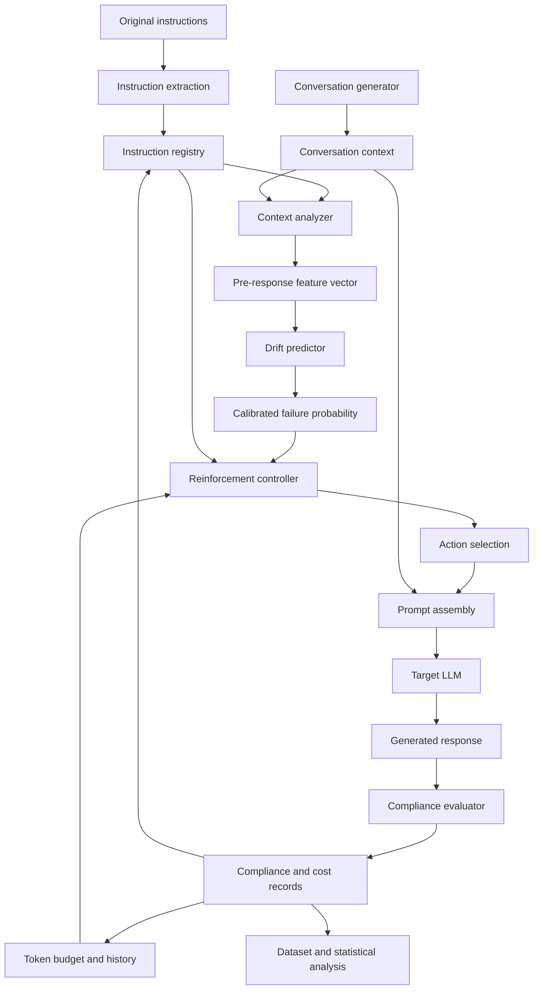

# System Architecture

## 1. Architectural principle

The system is a closed-loop experimental framework with a strict separation between:

- Target LLM execution.
- Instruction registry.
- Context feature extraction.
- Compliance evaluation.
- Drift prediction.
- Reinforcement decision-making.
- Experiment logging and analysis.

The drift predictor estimates risk. The controller selects an intervention. The compliance evaluator measures the resulting response. These components must remain independently testable.

## 2. High-level architecture

## 3. Component responsibilities

### 3.1 Instruction Registry

Responsibilities:
- Store atomic instructions and parent/group relationships.
- Record original text and normalized representation.
- Track category, priority, scope, and lifecycle.
- Record original token position and creation turn.
- Track reinforcement history.
- Track compliance history.
- Determine whether an instruction is active at a checkpoint.

The registry is the authoritative source of which instructions are currently applicable.

### 3.2 Conversation Generator

Responsibilities:
- Create controlled multi-turn conversations.
- Insert task-relevant and irrelevant content.
- Control instruction placement.
- Inject conflict scenarios.
- Create task transitions.
- Produce a reproducible conversation manifest.
- Support fixed random seeds and template IDs.

Use both templated and generated content. Store the generation method and seed.

### 3.3 Context Analyzer

Responsibilities:
- Count turns and tokens.
- Calculate instruction position and token distance.
- Estimate distractor and conflict characteristics from known generator metadata.
- Extract semantic features where enabled.
- Retrieve only historical data available before the predicted response.
- Emit a versioned feature vector.

For controlled synthetic experiments, use generator ground truth for distractor/conflict labels. For natural benchmark conversations, document how these labels are assigned.

### 3.4 Compliance Evaluator

Responsibilities:
- Evaluate each applicable instruction independently.
- Prefer deterministic checks.
- Support semantic judge evaluation when deterministic evaluation is infeasible.
- Record evaluator identity/version and evidence.
- Emit binary compliance plus optional severity and failure category.
- Support human audit labels.

### 3.5 Drift Predictor

Responsibilities:
- Estimate the probability that instruction `i` will be violated in the next response.
- Provide a calibrated probability.
- Support baseline and primary models.
- Store model version and feature schema version.
- Expose feature importance/SHAP analysis.

Prediction must happen before the target response is generated.

### 3.6 Reinforcement Controller

Responsibilities:
- Receive per-instruction risk scores.
- Consider instruction priority, lifecycle, token budget, cooldown, and prior action outcomes.
- Select an allowed action.
- Return an auditable decision record.
- Avoid repeatedly reinforcing inactive or superseded instructions.
- Enforce maximum reinforcement budget.

### 3.7 Prompt Assembler

Responsibilities:
- Construct the exact prompt sent to the target LLM.
- Preserve original conversation content.
- Insert reinforcement in a configured instruction-bearing role supported by the provider.
- Log the final serialized message sequence or a secure reproducible representation.
- Record the token count before and after reinforcement.

Do not assume that adding a reminder as a user message has the same authority as a system/developer instruction. Provider role semantics must be documented.

### 3.8 Target LLM Adapter

Responsibilities:
- Provide a common interface for different model providers.
- Support mock mode for tests.
- Record model name/version, provider, generation settings, response, usage, and latency.
- Handle bounded retries, timeouts, rate limits, and errors.
- Never silently substitute a different model.

### 3.9 Experiment Logger and Evaluator

Responsibilities:
- Persist prompts, responses, labels, feature rows, controller decisions, token counts, latency, and run configuration.
- Produce aggregate and instruction-level metrics.
- Generate plots and statistical reports.
- Preserve raw records for auditability.

## 4. Data flow at each checkpoint

1. Resolve active instructions from the registry.
2. Build the conversation prefix available before the next response.
3. Extract features for every active instruction.
4. Predict next-response failure risk for each instruction.
5. Apply the selected policy.
6. Assemble prompt with zero or more reinforcement messages.
7. Call target LLM.
8. Evaluate each applicable instruction against the response.
9. Record token cost, latency, and outcome.
10. Update histories for the next checkpoint.

## 5. Important architectural safeguards

- Prediction features cannot include the response being predicted.
- The evaluator cannot pass labels into the predictor before inference.
- The controller cannot change the original ground-truth instruction definition.
- Reinforcement text must not accidentally supersede the original instruction.
- The experiment runner must make baseline and adaptive prompts comparable.
- Store both the unmodified conversation and the actual reinforced prompt.
- Distinguish target-model tokens from evaluator-model tokens and controller computation.
