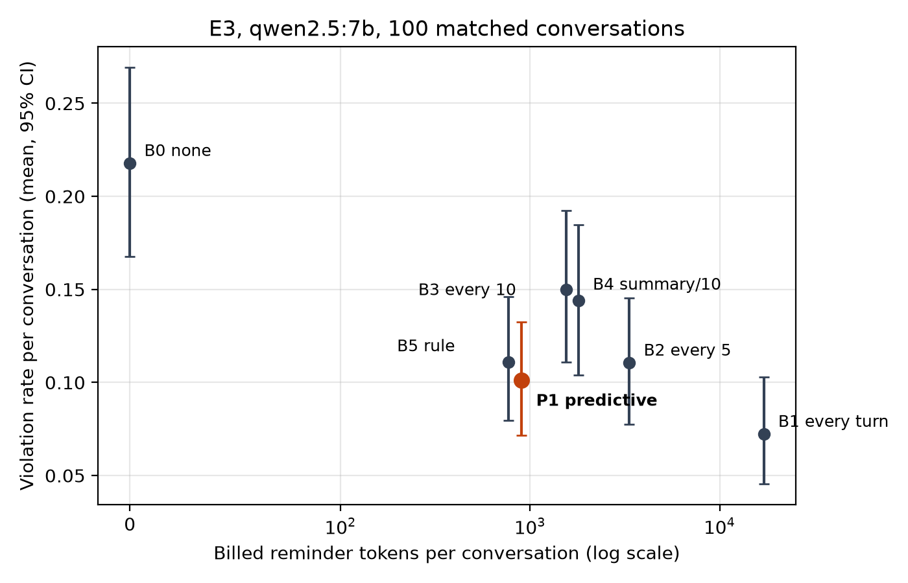

# E3: matched reinforcement comparison, qwen2.5:7b

Real-model results. Not simulated.

## Run

| Item | Value |
|---|---|
| Config | `configs/experiments/e3_reinforcement_kaggle.yaml`, seed 20261101 (new plans, unseen by the predictor) |
| Code | commit `acece01`, clean tree (cooldown amendment applied before any E3 result) |
| Model | `qwen2.5:7b`, digest `845dbda0…697e`, Ollama 0.40.13 (identical to E1) |
| Hardware | Kaggle T4 x2, one session, 8 h 3 min |
| Design | 100 plans x 7 policies, every policy on every plan (matched) |
| Calls | 11270 checkpoints (1610 per policy), 0 errors, 0 retries, 0 aborted |
| Runs | `e3_reinforcement_qwen7b_20261031T055233Z_157973`, `..._8dc16d` |
| Analysis | `scripts/analyze_e3.py` (seed 0), output `e3_qwen7b_analysis.json`; figure `scripts/plot_e3.py` |

Violation rate = violated applicable instruction checks / applicable checks, computed
per conversation and then averaged (95% CI: bootstrap over conversations). Billed
reminder tokens = reminder tokens present in the context at every model call, summed
per conversation (the real input overhead, since earlier reminders are re-sent).

## Per policy

| Policy | Violation rate (plan mean, 95% CI) | Pooled | No conflicts | Conflicts 0.2 | Billed reminder tokens / conversation | Share of prompt tokens |
|---|---|---|---|---|---|---|
| B0 none | 0.218 [0.168, 0.269] | 0.251 | 0.015 | 0.439 | 0 | 0.0% |
| B1 every turn | 0.072 [0.046, 0.103] | 0.080 | 0.001 | 0.143 | 17106 | 18.7% |
| B2 every 5 | 0.111 [0.078, 0.145] | 0.120 | 0.001 | 0.214 | 3341 | 4.2% |
| B3 every 10 | 0.150 [0.111, 0.192] | 0.164 | 0.004 | 0.291 | 1548 | 2.0% |
| B4 summary every 10 | 0.144 [0.104, 0.185] | 0.160 | 0.003 | 0.284 | 1800 | 2.3% |
| B5 rule threshold | 0.111 [0.080, 0.146] | 0.113 | 0.016 | 0.190 | 772 | 1.0% |
| **P1 predictive** | **0.101 [0.072, 0.132]** | 0.104 | 0.022 | 0.169 | **904** | **1.1%** |

## Pre-registered primary comparisons

Paired per conversation (n = 100). Wilcoxon signed-rank on non-zero differences, Holm
correction over the three tests.

| Comparison | Mean difference [95% CI] | Better / worse / tied | Holm p |
|---|---|---|---|
| P1 vs B0, violation rate | -0.117 [-0.156, -0.079] | 45 / 11 / 44 | 3.6e-7 |
| P1 vs B1, violation rate | +0.029 [+0.009, +0.050] | 16 / 32 / 52 | 0.013 |
| P1 vs B1, billed reminder tokens | -16202 [-18628, -13862] | 100 / 0 / 0 | 1.2e-17 |

1. P1 roughly halves the violation rate relative to no reinforcement.
2. Repeating every rule every turn (B1) is more compliant than P1, by 2.9 points.
3. P1 achieves that with 95% fewer billed reminder tokens (1.1% vs 18.7% of all prompt
   tokens). P1 recovers about 80% of B1's reduction (0.117 of 0.146) at about 5% of its
   reminder cost.

## Exploratory (not pre-registered, no multiplicity control)

- Difference vs B0 (mean, 95% CI): B1 -0.146 [-0.184, -0.110]; B2 -0.107 [-0.139,
  -0.076]; B3 -0.068 [-0.096, -0.039]; B4 -0.074 [-0.099, -0.049]; B5 -0.107 [-0.140,
  -0.074]; P1 -0.117 [-0.154, -0.080]. Every policy reduces violations.
- P1 and the fixed rule (B5) are close (0.101 vs 0.111) at similar cost. With these
  CIs, E3 does not show that the learned predictor beats the hand-written rule as a
  controller, even though it predicts better (E1 test ROC-AUC 0.965 vs 0.880).
- P1 matches B2 (every 5 turns) in compliance at 27% of B2's reminder cost.
- Without conflicts, violations are rare under every policy (11 of 758 checks for B0,
  17 for P1, Fisher p = 0.34). P1's slightly higher count is not distinguishable from
  noise. It is mostly in LEN_60 (6 vs 2).

## Limitations

- One model (qwen2.5:7b Q4_K_M), temperature 0, one conversation per plan and policy.
- Synthetic templates; violations are dominated by scripted conflicts (see E1). The
  benefit of reminders is measured mainly against in-context contradictions.
- 28 of 128 designed plans were excluded for every policy because B1 could overflow
  the context window. The 100-turn, high-density cell is under-represented.
- P1 was trained on B0 prefixes and sees non-empty reinforcement-history features here
  (distribution shift). Its probabilities under reinforcement were not recalibrated.
- The P1 and B5 cooldown (2 exchanges) was set from one demo conversation, not tuned.
- Histories diverge between policies after the first reply that differs, so later
  checkpoints compare conversations that are no longer identical. The comparison is
  per conversation (intention to treat), not per checkpoint.
- Compliance is output behaviour; it does not show what the model retained internally.
